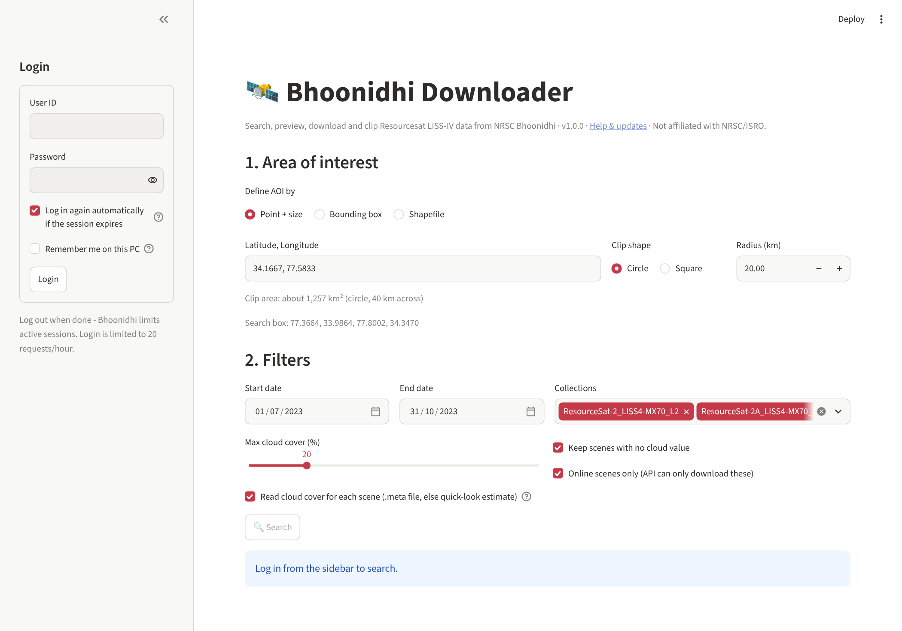

# 🛰️ Bhoonidhi Downloader

A simple app to **search, preview, download and clip ISRO Resourcesat satellite data (LISS-IV, LISS-III, AWiFS)** from the NRSC **Bhoonidhi** API — no coding needed.

You pick an area and dates, the app finds the scenes, shows you quick-look previews side by side, downloads the ones you choose (4 at a time) and clips them to your area.



> Not affiliated with NRSC or ISRO. You need your own free Bhoonidhi account. Please follow Bhoonidhi's terms of use.

---

## What it can do

- **Area of interest** in three ways: a point with a radius (circle) or size (square) in km, a bounding box, or your own shapefile / GeoJSON / GeoPackage (any projection).
- **Any date range.** Bhoonidhi allows only 366 days per search, so the app splits long ranges into yearly searches and merges the results.
- **Cloud cover filter.** Read from each scene's metadata file, or estimated from its quick-look image when the metadata has none.
- **Results table** showing location (path / row / subscene), how much of your area each scene covers, cloud %, and date.
- **Compare window.** 2–4 scenes of the same location side by side; all windows zoom and pan together. Works *before* downloading, using quick-looks.
- **Fast downloads.** 1–5 scenes at the same time (default 4), with automatic retry and **resume** if the internet drops.
- **Unzip + clip with GDAL.** Every band is clipped to your area, with an optional stacked GeoTIFF.
- **Stays logged in.** The token is refreshed every 18 min (also while idle), page reloads keep you logged in, and an optional "Remember me on this PC" setting logs you in when the app starts.
- **Remembers your settings** (download folder, clip options, parallel downloads).

---

## 1. Before you start

1. **A Bhoonidhi account.** Register at <https://bhoonidhi.nrsc.gov.in>. The app uses the same user ID and password.
2. **Miniconda (free) or Anaconda.** If you don't have either, install Miniconda: <https://docs.conda.io/en/latest/miniconda.html>. The default options are fine.

---

## 2. Install (Windows, the easy way)

1. On this page click the green **`Code`** button → **`Download ZIP`**, then unzip it (for example to `C:\Users\<you>\Bhoonidhi-Downloader`).
2. Open the folder and **double-click `install_windows.bat`**.
   The first install takes 5–15 minutes. Wait until it says *"Install finished"*.
3. **Double-click `run_windows.bat`.** The app opens in your web browser.
   Keep the black window open while you use the app; close it to stop the app.

That's it. From now on you only need **`run_windows.bat`**.

> 💡 Right-click `run_windows.bat` → *Send to* → *Desktop (create shortcut)* to get a desktop icon.

<details>
<summary><b>Install using Anaconda Prompt instead (if the .bat files don't work)</b></summary>

Open **Anaconda Prompt** and run:

```bat
cd C:\Users\<you>\Bhoonidhi-Downloader
conda env create -f environment.yml
conda activate bhoonidhi
streamlit run app.py
```

Next time:

```bat
conda activate bhoonidhi
cd C:\Users\<you>\Bhoonidhi-Downloader
streamlit run app.py
```

If Streamlit asks for an email, just press **Enter**.
</details>

<details>
<summary><b>Linux / macOS</b></summary>

```bash
git clone https://github.com/anurag-tm/Bhoonidhi-Downloader.git
cd Bhoonidhi-Downloader
./install.sh     # one time
./run.sh         # every time
```
</details>

<details>
<summary><b>Using pip instead of conda</b></summary>

```bash
pip install -r requirements.txt
streamlit run app.py
```

GDAL is not installed this way, so **"Unzip and clip"** stays off. Everything else works. To enable clipping, install GDAL (easiest: `conda install -c conda-forge gdal`).
</details>

### Optional: check your account first

```bat
conda activate bhoonidhi
python test_connection.py
```

It logs in, lists a few scenes and logs out. If you see *"Everything works"*, the app will work too.

---

## 3. How to use

| Step | What to do |
|---|---|
| **Login** (left sidebar) | Enter your Bhoonidhi user ID and password. Keep *"Log in again automatically"* ticked. Tick *"Remember me on this PC"* if you want automatic login next time. |
| **1. Area of interest** | *Point + size*: enter `latitude, longitude`, choose **Circle** (radius) or **Square** (side length) in km. Or enter a *Bounding box*, or upload a *Shapefile* (`.zip`, or `.shp` + `.shx` + `.dbf` + `.prj` together). |
| **2. Filters** | Pick **Start date** and **End date**, the collections (LISS-IV by default) and the **max cloud cover %**. Click **🔍 Search**. |
| **3. Results** | Each scene shows its **Location** (path / row / subscene), **AOI covered %** and **Cloud %**. Choose scenes with **100 % AOI covered**, and tick the ones you want. |
| **4. Compare** *(optional)* | Pick a **Location**, then 2–4 dates. Choose *Quick-look* to preview before downloading, and turn on **Open comparison viewer**. Pan or zoom one window and the others follow. |
| **5. Download & clip** | Check the **download folder**. Tick *Unzip and clip to AOI* to get only your area, optionally *Stack bands*. Set **Parallel downloads** (1–5). Click **⬇️ Download**. |
| **Finish** | Click **Logout** in the sidebar, then close the black window. |

### Where your files go

```
liss4_downloads/
├── <scene>.zip                  full scene as downloaded
├── <scene>/                     unzipped full scene
└── <scene>_clip/
    ├── BAND2_clip.tif           each band clipped to your area
    ├── BAND3_clip.tif
    ├── BAND4_clip.tif
    └── <scene>_stack_clip.tif   all bands in one file (if "Stack" is ticked)
```

Untick *"Keep full scene after clipping"* to save disk space; only the clipped files are kept.

---

## 4. Good to know

- **Only "online" scenes can be downloaded through the API.** Offline scenes must be ordered on the Bhoonidhi website.
- **The API gives only full scenes.** The app downloads the full scene, then clips it on your PC.
- **Cloud % estimated from quick-looks counts snow and glaciers as cloud.** In winter or over glaciers, set the cloud limit higher and check scenes in the Compare window.
- **Quick-looks are low-resolution** and placed approximately on the map. Downloaded and clipped images are placed exactly, shown as false colour (NIR-Red-Green).
- **Bhoonidhi's limits:** max 5 downloads at once and about 20 logins per hour. Log out when you're done.
- **If downloading stops** (internet cut, PC sleep), click **Download** again: finished scenes are skipped and half-done ones resume.

---

## 5. Problems?

| Message / problem | What to do |
|---|---|
| `401` Session expired | The app logs in again by itself. If it keeps happening, log out and log in. |
| `403` Max sessions | Too many open sessions. Log out on the Bhoonidhi website and wait a few minutes. |
| `404` / *No scenes found* | Widen the dates or the area, or untick *"Online scenes only"*. |
| `412` Too many downloads | Lower *Parallel downloads* to 3 or less. |
| `429` Rate limit | Wait ~1 hour (too many logins or searches). |
| *Clipping needs GDAL* | Run `install_windows.bat` again, or `conda install -c conda-forge gdal`. |
| *Remember me* is greyed out | `conda install -c conda-forge keyring`, then restart the app. |
| Streamlit asks for an email | Press **Enter** (leave it blank). |
| Logged out after a reload | Update to the latest version. Login now survives page reloads. |

Still stuck? Open an issue: <https://github.com/anurag-tm/Bhoonidhi-Downloader/issues>

---

## 6. Update to a new version

Download the new ZIP (or run `git pull`), replace the old files, then run `install_windows.bat` once more. Your settings and downloads are kept.

---

## Privacy

- Your password is kept only in the app's memory while it runs.
- With *"Remember me on this PC"* it is saved in **Windows Credential Manager** (or the macOS Keychain), never in a text file. *"Logout and forget me on this PC"* removes it.
- `bhoonidhi_settings.json` stores only the download folder and options, never your password.
- The app talks only to Bhoonidhi (`bhoonidhi.nrsc.gov.in`) and loads the basemap for the Compare window.

---

## License

[MIT](LICENSE) © 2026 Anurag Sharma, Glaciology Lab, Department of Remote Sensing & GIS, University of Jammu.

Data © NRSC / ISRO, provided through Bhoonidhi.
